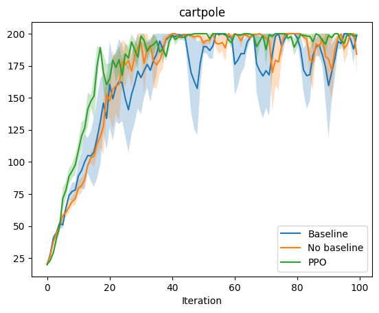
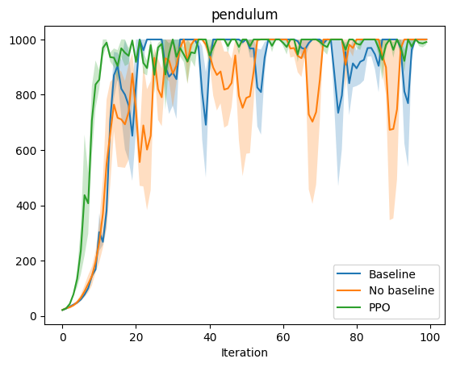
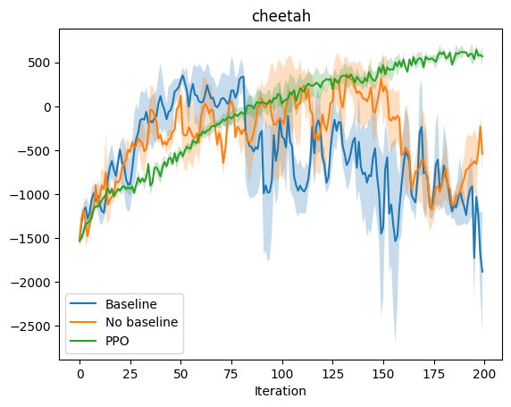

# Assignment 2
* Brief [instructions and installation] for [Assignment2].
* For detailed executions, see [assignment2.ipynb].

## Note
* Implemented algorithms:
  * [x] Policy Gradient (with baseline)
  * [x] Proximal Policy Optimization (PPO)

## Result
3 methods across 3 environments over 3 seeds.  
  
  

[instructions and installation]: README_.md
[Assignment2]: https://web.stanford.edu/class/cs234/assignments/a2/CS234_A2_Questions.pdf
[assignment2.ipynb]: assignment2.ipynb
