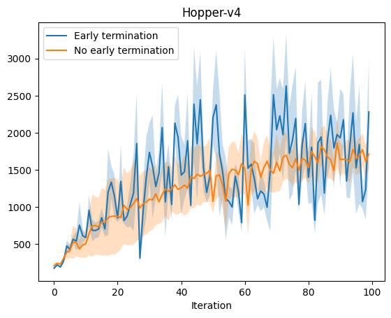
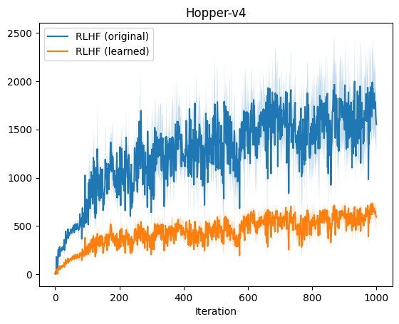
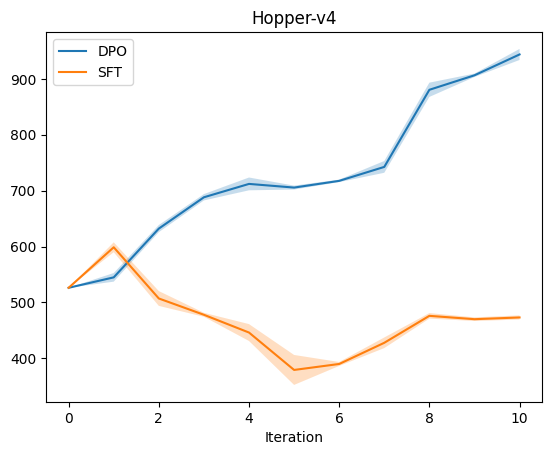

# Assignment 3
* Brief [instructions and installation] for [Assignment3].
* For detailed executions, see [assignment3.ipynb].

## Note
* Implemented algorithms:
  * [x] Reinforcement Learning from Human Preferences (RLHF)
  * [x] Direct Preference Optimization (DPO)

## Result
### 1 Reward Engineering
* Learning curves  
  
* Evaluation rollouts
  | with early termination | without early termination |
  |:----------------------:|:-------------------------:|
  |   |   |
### 2 Learning from Preferences
* Learning curves  
  
* Evaluation rollouts  
  
  
### 3 Direct Preference Optimization
* Learning curves  
  
* Evaluation rollouts

## Reference

[instructions and installation]: README_.md
[Assignment3]: https://web.stanford.edu/class/cs234/assignments/a3/hw3_questions.pdf
[assignment3.ipynb]: assignment3.ipynb
[1-wet_eval_ep2]: results/1-wet_eval_ep2.gif
[1-wet_eval_ep9]: results/1-wet_eval_ep9.gif
[1-woet_eval_ep1]: results/1-woet_eval_ep1.gif
[1-woet_eval_ep8]: results/1-woet_eval_ep8.gif
